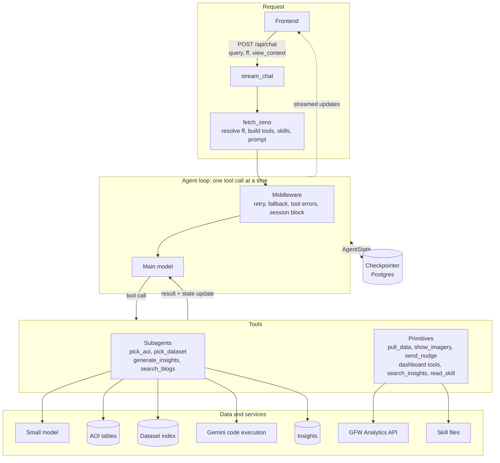

# Agent architecture

The Zeno agent is a LangChain agent (`create_agent`) that runs on LangGraph.
It answers questions about geospatial data. It does this only by calling
tools. It must not invent data.

## Overview

## Request flow

1. The frontend sends `POST /api/chat`. The body has the query, an optional
   feature flag (`ff`) and the `view_context` (the page the user is on).
2. `fetch_zeno` gets the profile for `ff` and builds the agent for this
   request only.
3. Before each model call, `SessionContextMiddleware` adds a session block.
   This block shows the current AOI, dataset, dates, pulled data and insight.
4. The model calls one tool at a time. Each tool returns a message and
   updates `AgentState`.
5. The API streams each state update to the frontend. The checkpointer saves
   the state in Postgres, for each thread.

## Concepts

| Concept | What it is | Where |
|---|---|---|
| Profile | A set of tools and skills, selected with `ff`. Profiles extend other profiles: `base` → `default` → `experimental`. | `agent_config.py`, [feature-flags.md](../src/agent/docs/feature-flags.md) |
| Tool | A function the model can call. Its `SPEC` holds the tool and its prompt text. | `src/agent/tools/` |
| Subagent | A tool that does its own LLM work. The main model sends only the user's intent. | `src/agent/subagents/` |
| Skill | A Markdown recipe for a multi-step task. The prompt lists only the name and "use when" text. The model loads the full recipe with `read_skill`. A skill adds the tools in its `requires:` list. | `src/agent/skills/skills_md/` |
| State | `AgentState`: messages, AOI, dataset, dates, statistics, insight, nudge, dashboard. | `state.py` |
| Session block | A state summary that the middleware adds before each model call. | `middleware.py` |
| View page | Prompt text for the page the user is on. | `view_pages.py` |
| Insight | A saved chart and its text. It is a database record, not part of the agent state. | `src/api/repositories/insight_writer.py` |

## Subagents

| Subagent | What it does |
|---|---|
| `pick_aoi` | Finds the area in the Postgres AOI tables. The small model selects the best match. |
| `pick_dataset` | Finds candidates in the dataset index. The small model selects one dataset, layer and date range. |
| `generate_insights` | Makes charts from the pulled data. Curated datasets use fixed charts. Other datasets use Gemini code execution. Saves the result as an insight. |
| `search_blogs` | Searches the WRI Insights articles with a deep agent on a read-only file system. |

## Models

The main model, the small model and the fallback models are set in
`src/agent/config.py`. `src/agent/llms.py` contains the available models. If the
main model fails, `ModelRetryMiddleware` tries again. Then
`ModelFallbackMiddleware` uses the fallback models.

## How to extend the agent

- **Add a tool.** Write the tool and its `SPEC`. Add the `SPEC` to
  `ALL_SPECS` in `agent_config.py`. Add it to a profile, or to the
  `requires:` list of a skill.
- **Add a skill.** Add a Markdown file to `skills_md/` with `name`,
  `description`, `when_to_use` and `requires`. Add the skill to a profile.
- **Add a dataset.** Add a YAML file to `src/agent/datasets/catalog/`. Then
  rebuild the dataset index with `src/ingest/embed_datasets.py`, under a new
  version name.
- **Change a profile.** Update the snapshot in
  `tests/unit/agent/test_profile_manifest.py`.
